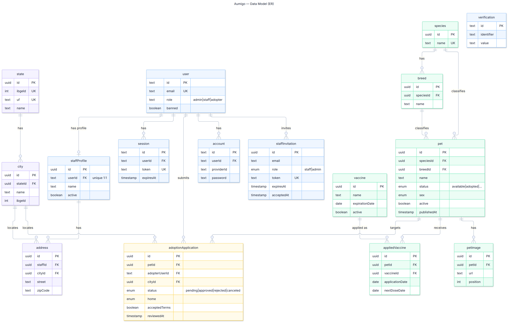
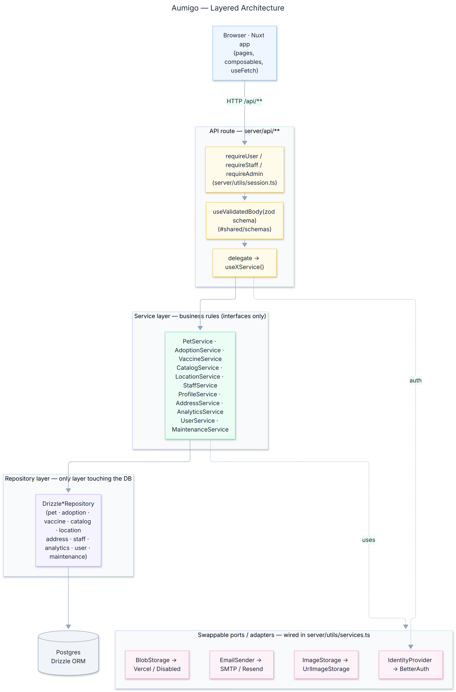
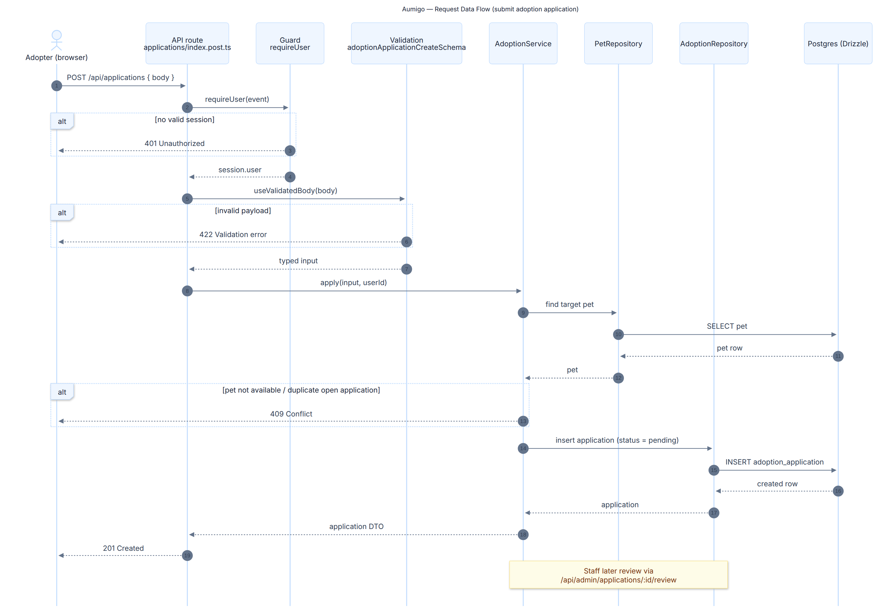
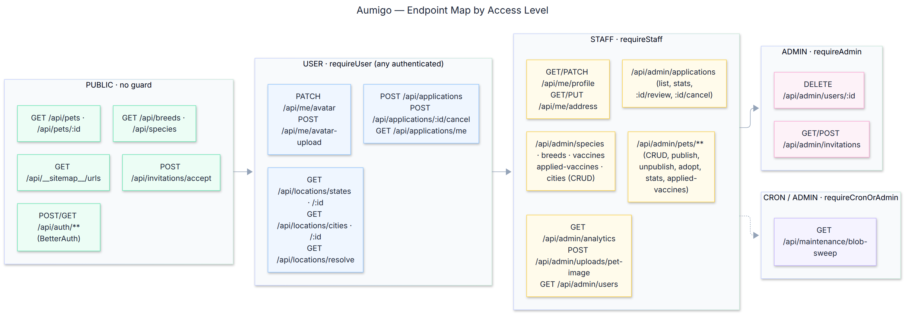

# Aumigo — Diagrams

Visual reference for Aumigo's domain model, architecture, request flow, and API
surface. Images are rendered from the Mermaid sources in
[`docs/diagrams/src/`](diagrams/src/); edit a `.mmd` file and regenerate with:

```bash
pnpm diagrams:render
```

Each diagram below embeds a PNG (for quick preview) and links the crisp SVG. A
shared pastel palette is reused across all diagrams so a color always means the
same domain:

| Color     | Domain                                    |
| --------- | ----------------------------------------- |
| 🟦 Blue   | Auth / identity                           |
| 🟩 Green  | Catalog (pets, species, breeds, vaccines) |
| 🟨 Amber  | Adoption / API routes                     |
| 🟪 Violet | Location / repositories                   |
| 🩷 Pink   | Ports & adapters                          |

## Data model (ER)

The 16 tables and their relationships. See
[`server/database/schema/`](../server/database/schema/) for the source of truth.

[](diagrams/er-model.svg)

_[Open SVG](diagrams/er-model.svg)_

<details><summary>Mermaid source</summary>

See [`diagrams/src/er-model.mmd`](diagrams/src/er-model.mmd).

</details>

## Layered architecture

The strict server layering (route → service → repository → DB) and the swappable
ports/adapters wired in [`server/utils/services.ts`](../server/utils/services.ts).

[](diagrams/architecture.svg)

_[Open SVG](diagrams/architecture.svg)_

<details><summary>Mermaid source</summary>

See [`diagrams/src/architecture.mmd`](diagrams/src/architecture.mmd).

</details>

## Request data flow

The request lifecycle (`guard → validate → service → repository → Postgres`),
shown for the submit-adoption-application path
([`server/api/applications/index.post.ts`](../server/api/applications/index.post.ts)).

[](diagrams/data-flow.svg)

_[Open SVG](diagrams/data-flow.svg)_

<details><summary>Mermaid source</summary>

See [`diagrams/src/data-flow.mmd`](diagrams/src/data-flow.mmd).

</details>

## Endpoint map

All `/api/**` endpoints grouped by access level and the guard each uses
([`server/utils/session.ts`](../server/utils/session.ts)).

[](diagrams/endpoint-map.svg)

_[Open SVG](diagrams/endpoint-map.svg)_

<details><summary>Mermaid source</summary>

See [`diagrams/src/endpoint-map.mmd`](diagrams/src/endpoint-map.mmd).

</details>

## Regenerating

The renderer ([`scripts/render-diagrams.mjs`](../scripts/render-diagrams.mjs))
loads each `.mmd` source, applies the shared theme
([`diagrams/src/theme.json`](diagrams/src/theme.json)), and writes a `.svg` and a
2× `.png` per diagram using the Chromium already installed for the e2e suite — no
extra system dependencies. Commit the regenerated images alongside the source
changes.
